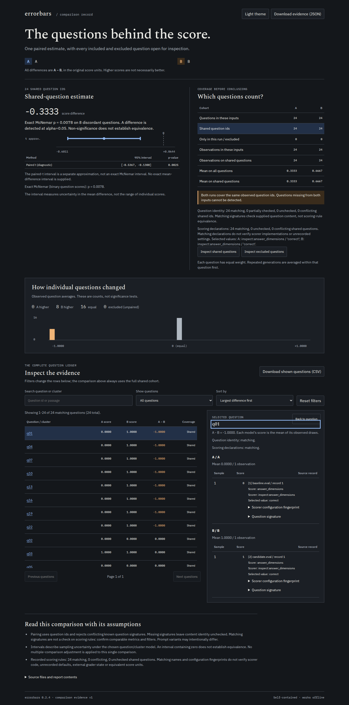

# Compare a named Inspect score without flattening away its meaning

Source feature, verified 2026-10-12. Not yet released to PyPI or the hosted apps.

[Inspect supports a scorer returning several named values](https://inspect.aisi.org.uk/multiple-scorers.html).
The baseline Errorbars importer rejected every such dictionary, even with an
explicit scorer name. [Before receipt](evidence/before.json) reproduces the
rejection on the pre-existing `shape` fixture and all three new native captures
against archived source `3e63c255e83381f2151e1353048d5f16e1408326`.

The new `--score-key` selects one value on **every** sample. It works for import,
summary, comparison and leaderboard commands, and as `score_key` in the Python
adapters. It does not infer a selection from key order, pool different values,
or drop samples missing the requested grade.

## Try the retained logs

From this source checkout, with the Inspect extra installed:

```sh
uv sync --extra inspect
uv run errorbars compare A=examples/inspect-values/logs/baseline.eval B=examples/inspect-values/logs/candidate.eval --score-key correct --html /tmp/inspect-correct.html
uv run errorbars compare A=examples/inspect-values/logs/baseline.eval B=examples/inspect-values/logs/candidate.eval --score-key words --json
```

`--scorer answer_dimensions` may be added; it is unambiguous in these logs.
`--scorer` chooses the scoring function, `--score-key` chooses one value that
function returned. `--metric` remains the separate lm-eval metric selector.



## What the experiment contains

`capture.py` runs Inspect AI 0.3.268 with its actual `mockllm/model` provider and
a deterministic callback. The 24 arithmetic questions, responses and scores
are **synthetic controls**, not evidence of any model's capability. No model API,
external dataset or paid grader is used.

One scorer emits three named values for each response: `correct` is the native
`C`/`I` grade for an exact answer, `concise` is a boolean two-word-budget check,
and `words` is a numeric word count. A third run records the candidate for two
epochs. The 96 observations are retained in unedited `.eval` files with SHA-256
hashes, original responses and aggregate SDK results in [the manifest](logs/manifest.json).
The logs contain no workspace paths.

| Selected value | A mean | B mean | A minus B | Selected inference | Independent p-value |
| --- | ---: | ---: | ---: | --- | ---: |
| `correct` | 0.333333 | 0.666667 | -0.333333 | Exact McNemar | 0.0078125 |
| `concise` | 0.333333 | 1 | -0.666667 | Exact McNemar | 0.000030517578125 |
| `words` | 3 | 1 | 2 | Paired t | 0.0000006444485482 |

These are different quantities; higher is not always better. `replay.py`
recomputes every grade from the recorded response without using Errorbars'
converter, compares the selected vectors exactly, and checks inference against
SciPy `binomtest` or `ttest_rel`. [After receipt](evidence/after.json) retains the
results, canonical CSV round-trips and CLI checks. The two-epoch summary keeps
48 observations and 24 equally weighted questions.

When A's `correct` values are combined with B's `concise` values, all 24 shared
questions have conflicting scoring declarations. Inference is unavailable and
both compare and leaderboard commands fail after canonical CSV round-trip.
The source questions and scorer parameters still match. This prevents a change
of selected dimension from masquerading as a model improvement.

## Preserve the choice

```sh
uv run errorbars import inspect A=examples/inspect-values/logs/baseline.eval B=examples/inspect-values/logs/candidate.eval --score-key correct -o /tmp/inspect-correct.csv
uv run errorbars compare /tmp/inspect-correct.csv --json
```

Canonical CSV/JSONL uses `scorer`, `scorer_config` and the new `scorer_value`.
Python `ScoringRule.value_key` stores the same selection. Omitting the selected
key from later exports loses that evidence; older releases do not implement the
new check. The chosen key is an exact nonblank top-level string, with case and
punctuation preserved. There is no nested-path syntax. Missing keys, nulls,
unrecognized strings and nonfinite selected values reject the whole import.
An unselected dimension is outside the statistical analysis.

The existing cohort-completeness and question-identity checks still apply.
Matching names, selected keys and recorded parameter fingerprints do not prove
equal scorer code, external grader state or score units. If matching per-value
parameter metadata is absent, configuration remains unchecked. Scorer parameters
are fingerprinted, not copied into report text.

## Reproduce and inspect

```sh
uv run python examples/inspect-values/capture.py /tmp/new-inspect-value-captures
uv run python examples/inspect-values/replay.py /tmp/inspect-value-replay
node examples/inspect-values/browser.mjs /tmp/inspect-value-replay /tmp/inspect-value-browser
```

The first command requires a new directory and records new SDK logs. The second
replays the committed logs, so capture timestamps and hashes stay inspectable.
It uses SciPy as an independent oracle; `--without-scipy` instead checks against
the retained oracle receipt for installed-artifact verification. Browser tools
come from `web/node_modules` (`npm ci --prefix web`); engines must be installed.

[Browser evidence](evidence/browser.json) covers four reports in each of
Chromium/Firefox at 1440px/dark and 375px/light: correctness, brevity, word count
and conflicting dimensions. All 16 workflows run offline. Keyboard inspection
shows the selected value beside its source record; all 32 downloaded JSON/CSV
artifacts retain the appropriate selection after filtering. Complete JSON still
contains all 24 questions. The inspected correctness state has no axe violations.
No page errors, external requests, CSP violations or page overflow were observed.
All four [screenshots](../../docs/assets/inspect-values/) were inspected.
