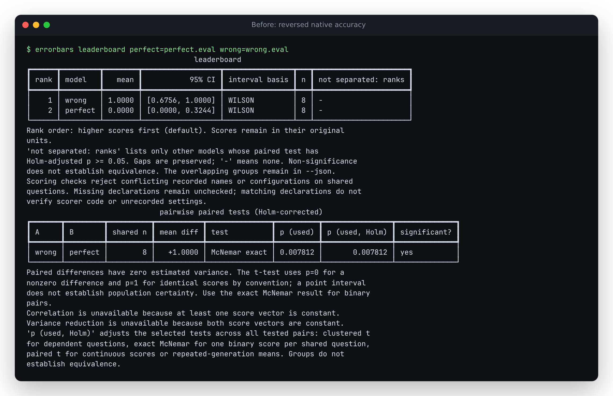
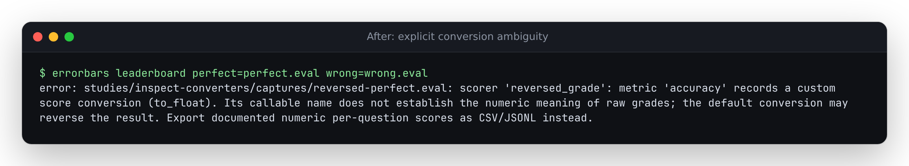

# Native score conversion can reverse a leaderboard

At baseline `58797b4`, Errorbars ranked a completely wrong run above a perfect
run, although Inspect's own accuracy was 0.0 versus 1.0. The scorer encoded
correct answers as numeric `0` and wrong answers as `1`, using Inspect's
documented `accuracy(to_float=value_to_float(correct=0, incorrect=1))` mapping.
Errorbars substituted its default mapping and treated raw `1` as success.

This is a controlled reproduction, using **six actual successful Inspect
evaluations** with the built-in mockllm provider, eight synthetic questions,
scripted outputs and native `.eval` writers. There is no trained-model
benchmark, external dataset or model API call.



## Result

| Input | Inspect: perfect / wrong | Baseline Errorbars | Repaired source |
|---|---|---|---|
| Numeric grades with reversed converter | Accuracy 1.0 / 0.0 | Mean 0.0 / 1.0; wrong run first | Refused before analysis or export |
| Named `reversed` value with converter | Accuracy 1.0 / 0.0 | Mean 0.0 / 1.0; wrong run first | Refused for this selected value |
| Default `C` / `I` grades | Accuracy 1.0 / 0.0 | Perfect run first | Same valid result |
| Named `plain` value, default conversion | Mean 1.0 / 0.0 | Perfect run first | Same valid result |

Both erroneous comparisons selected exact McNemar inference and reported
p = 0.0078125 for the reversed result. Correct computation on the wrong grade
scale still makes the wrong model claim.

The [native captures](captures/) are unedited outputs, renamed for readability.
Their [manifest](captures/manifest.json) records checksums and native results.
[Before](results/before.json) and [after](results/after.json) record library
ranking plus actual `summarize`, `compare`, `leaderboard` and `import` commands.
Refusal preserves prior canonical CSV, comparison HTML and forest-plot files.

## Why refuse

Inspect's [custom scorer documentation](https://inspect.aisi.org.uk/custom-scorers.html)
allows custom grade conversion. The installed SDK's accuracy and mean metrics
apply a `to_float` callable to individual values. In these native logs the
recorded parameter is only `{"to_float": "to_float"}`. Different closures share
that name. It cannot establish the numeric mapping and must not be executed or
treated as a declaration of the default converter.

Errorbars now checks the selected scorer/value's **result** metadata before
converting any grades. Original `eval.scorers` declarations may be stale after
re-scoring. A custom converter in another named dimension does not invalidate
an independently selected default dimension. Removing scorer parameters does
not erase a known converter in metric parameters.

Explicitly supplying the default callable also causes refusal: its logged name
cannot distinguish it from a customized closure. For such runs, produce reviewed
numeric per-question scores with documented units, then use canonical CSV/JSONL.
Do not remove the converter declaration merely to bypass the check.



## Reproduce

```sh
uv sync --locked --group dev --extra all
uv run python studies/inspect-converters/replay.py /tmp/converter-replay.json --check
uv run errorbars leaderboard \
  perfect=studies/inspect-converters/captures/named-perfect.eval \
  wrong=studies/inspect-converters/captures/named-wrong.eval --score-key plain
```

`capture.py` regenerates the six native logs with the invoking Inspect SDK.
The retained logs suffice for replay; no model service is needed. To replay
the baseline, set `PYTHONPATH` to that revision's `src/`, using the same script
and interpreter. The package's optional `inspect` dependency is required.

## Limits

This detects an explicitly recorded `to_float` callback. It does not recover
arbitrary metric code, closures, custom reducers or undeclared conversions.
Absent metric metadata stays unchecked. Matching scorer declarations do not
authenticate graders or establish equivalent model settings. The valid controls
check this boundary, not general model accuracy or statistical calibration.

This source change does not release a registry package or deploy a hosted app.
