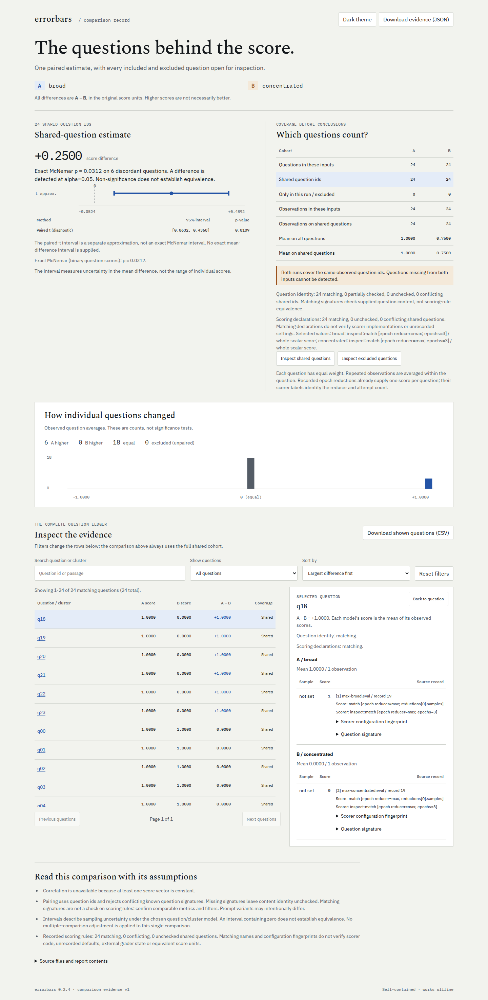

# Inspect epoch reducers change the question being compared

At baseline `661ff99`, Errorbars silently replaced every native Inspect epoch
reducer with an arithmetic mean of the raw attempts. On the retained `max`
runs, that reversed the ranking: Inspect reported **1.00 versus 0.75** while
Errorbars reported **0.33 versus 0.75**, with paired-t p = 0.0001215761 in the
opposite direction.

These are **18 actual successful Inspect 0.3.268 evaluations**, using 24 authored
questions, three epochs and a scripted solver with the built-in mockllm model.
No trained model, public benchmark, provider request or paid service is involved.
The broad solver succeeds once on every question. The concentrated solver
succeeds on all three attempts for 18 questions and fails all attempts on six.

| Native view | Broad / concentrated | Baseline Errorbars | Corrected import |
|---|---|---|---|
| Mean | 1/3 / 3/4 | Same | Same 72 raw attempts per run |
| Max | 1 / 3/4 | 1/3 / 3/4; reversed ranking | 24 retained question scores; exact McNemar p = 0.03125 |
| Pass at 2 | 2/3 / 3/4 | 1/3 / 3/4 | 24 retained fractional scores; paired-t p = 0.3656106416 |
| Median, mode, at least 2 | 0 / 3/4 | 1/3 / 3/4 | Native binary question scores |
| Mean and max together | Two distinct views | Silently reported mean | Explicit `--inspect-reducer` selection |
| Named max `correct` / `loss` | Separate retained dimensions | Mean of each raw dimension | Selected native dimension and reducer retained |
| Reducers disabled | 1/3 / 3/4 | Same | Raw epochs retained; question means still define analysis |



The [native captures](captures/) are copied verbatim from Inspect's writer;
[manifest.json](captures/manifest.json) records their hashes and native results.
[Before](results/before.json) and [after](results/after.json) retain actual imports,
rankings, inference and CLI runs. Ordinary/disabled-mean controls and
selected reducer cases remain distinct rather than pooling different policies.

## Use

Install this source with the `inspect` extra, or run `uv sync --locked --extra inspect`
in the checkout. No registry release is implied by this correction.

```sh
uv run errorbars compare \
  broad=studies/inspect-reducers/captures/mean-max-broad.eval \
  concentrated=studies/inspect-reducers/captures/mean-max-concentrated.eval \
  --inspect-reducer max --html max.html --json
```

Changing `max` to `mean` selects the other recorded policy. A sole non-mean
reducer is selected automatically. `--score-key correct` independently selects
a dictionary-valued score. Python callers use
`load_inspect_log(path, inspect_reducer="max", score_key="correct")` or the same
keyword arguments on `load_inputs`.

## What is preserved

Non-mean imports read `log.reductions` using Inspect's own reader. They do not
rerun registered functions, infer a missing reducer or substitute the raw mean.
Each original question must have exactly one reduced score. Missing, duplicate,
unknown or invalid scores reject the whole import. Raw epochs are validated
first, so changed question content, failed samples or incomplete runs cannot
be hidden by a complete-looking reduction.

The normalized score definition includes the reducer and epoch count, alongside
the original scorer parameters and selected dimension. These declarations
survive canonical CSV. Comparing a max score with a mean, another reducer or
another attempt budget blocks paired inference. Current result metadata takes
precedence over initial eval configuration, which can predate re-scoring.

Native reduced source records name the exact `reductions[index].samples` array;
their one-based record number indexes that array. They are not references to
raw sample records. Original attempts remain in the input `.eval` file. A CSV
round trip points to its CSV records and retains the score definition, rather
than claiming it still has native-record provenance.

Ordinary mean imports retain individual epochs and the original within/between
variance diagnostics. The [other 24 retained Inspect logs](results/controls-after.json)
keep their previous outcomes: 16 accepted canonical CSVs are byte-identical to
[baseline](results/controls-before.json), and eight unsupported/incomplete inputs
remain refused. Scalar scorer names now appear in report and CLI score labels
alongside named dimensions.

## Independent checks and limits

The authored raw outcomes establish each expected reduction independently. For
pass at 2 with one success in three draws, the draw-without-replacement value is
`1 - C(2,2)/C(3,2) = 2/3`. Import tests compare retained values and check paired-t
inference against SciPy and exact binary inference against `scipy.stats.binomtest`.
These checks establish this ingestion boundary, not model performance or general
statistical calibration.

[Inspect's metrics guide](https://inspect.aisi.org.uk/metrics.html#reducing-epochs)
explains that epoch reducers produce a per-question view before metrics run.
Errorbars estimates the arithmetic mean of those recorded question scores,
not an arbitrary corpus-level metric such as F1 or a custom aggregate. It
requires supported finite scalar grades in both the raw and selected view.
It retains its existing refusal of opaque metric `to_float` callbacks.

A recorded reducer name does not authenticate its implementation or recover
unrecorded parameters and closures. Matching declarations do not establish
that two custom reducers or graders ran equivalent code. The attempt-count
compatibility check is conservative, including for estimators such as pass at k
that may target the same quantity with different numbers of samples. No missing
native values are recreated to relax that boundary.

Binary reduced observations use exact McNemar; fractional observations use
paired t unless supplied clusters select clustered inference. The analysis unit
is the question. A best-of-three success is not three independent question
successes. Reduced imports do not expose raw-generation variance diagnostics;
use the original mean view for those diagnostics when it was recorded.

## Reproduce

```sh
uv run python studies/inspect-reducers/replay.py --check \
  --out /tmp/reducers.json --artifacts /tmp/reducer-reports
uv run python studies/inspect-reducers/controls.py --out /tmp/reducer-controls.json
node studies/inspect-reducers/browser.mjs /tmp/reducer-reports /tmp/reducer-browser
```

`capture.py DESTINATION` regenerates the 18 native logs using the invoking Inspect
SDK. `replay.py` also runs against the baseline source on `PYTHONPATH`; it records
unavailable selectors honestly. Its corrected replay checks 12 cases, canonical
round trips and 48 actual CLI commands. `browser.mjs` opens generated files
with networking disabled before first load, exercises keyboard inspection,
checks the filtered CSV and full JSON downloads, and ensures filtering does not
change inference.

The [verification receipt](results/verification.json) records a fresh source
archive at `70c12fefa85f137ae82035beec0b350c425b932d`, built wheel/sdist and
30 identical installed runtime files. Python 3.14.7 and the installed wheel on
Python 3.10.21 each passed the full 865-test suite; the latter used NumPy 1.24.0
and Inspect 0.3.268. Web checks passed, including 52 application and 42 installed
standalone-report browser cases. Two initial simultaneous suites collided in a
shared trace directory; both complete suites passed with separate output paths.

The installed wheel with Inspect 0.3.281 passed 12 reducer cases and 48 CLI
commands. Eighteen additional native runs generated by that SDK were read by
both 0.3.281 and the 0.3.268 floor: each reader checked 22 selected views and
528 question values against the authored closed forms. The additional runs'
[manifest](results/native-0281-manifest.json) and reader receipts are retained;
their binaries remain local. Regenerate them with the recorded SDK and run
`native_compat.py CAPTURE_DIRECTORY OUTPUT_JSON`.

[Twenty actual offline browser workflows](results/browser-installed.json)
in Chromium and Firefox at 1440 and 375 pixels checked native max, pass-at-2,
mean, named max and CSV round trips. All 40 real JSON/CSV downloads matched
the displayed evidence; keyboard inspection worked, filtering preserved the
estimate, and there were no HTTP requests, page errors or horizontal overflow.
All 12 new screenshots and eight baseline screenshots were inspected. Long
score definitions wrap; full original score precision remains available.

The correction was pushed to GitHub. [All 62 checked public files](results/public-source.json),
including all changed files and 30 runtime files, match the pinned revision.
A [fresh actual pip upgrade](results/public-install.json) replaced the older
registry 0.2.4 with this source and checked every runtime file. No registry
release, tag, hosted calculator update or Hugging Face deployment is implied.
