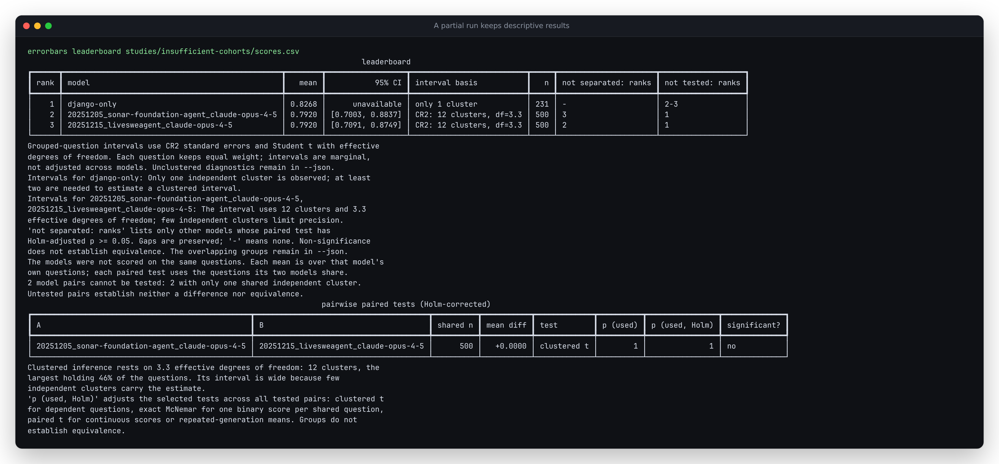

# A partial run must not erase the leaderboard

A leaderboard now retains observed means and counts when an individual run
cannot estimate an interval. Before this repair, adding a Django-only run to
two complete retained SWE-bench submissions made the whole command exit 1.
The complete runs' estimates and paired comparison were lost too.

This is an **unreleased source change**, with no package publication or hosted
deployment. It changes the Python entry type: `se`, `ci_low` and `ci_high` can
be `None`, serialized as JSON `null`.

## Reproduction using retained outcomes

[`scores.csv`](scores.csv) contains the two highest-scoring submissions in the
repository's retained [SWE-bench outcomes](../swe-bench-verified/data/outcomes.json).
Both have all 500 tasks and 12 repository clusters. `django-only` deliberately
restricts the first submission to its 231 Django tasks. This partial run is
**constructed for the reproduction**, not a published submission or a new
model evaluation. [`input.json`](input.json) identifies the two submissions,
the source hash, and the restriction. The source study documents its provenance
and limitations; no upstream data was downloaded again for this repair.

```bash
errorbars leaderboard studies/insufficient-cohorts/scores.csv --json --plot partial.svg
```

At baseline `b2375ec`, this returned no JSON and no SVG:

```text
error: model 'django-only': need at least 2 independent clusters for an interval
```

The same command now succeeds:

| Run | Questions | Clusters | Mean | 95% interval |
|---|---:|---:|---:|---|
| Constructed Django-only subset | 231 | 1 | 0.826840 | unavailable |
| `20251205_sonar-foundation-agent_claude-opus-4-5` | 500 | 12 | 0.792000 | [0.700290, 0.883710] |
| `20251215_livesweagent_claude-opus-4-5` | 500 | 12 | 0.792000 | [0.709111, 0.874889] |

These means cover different cohorts. The higher Django-only mean does not
establish a better model. Its two pairs are explicitly untested, each with
`n_shared: 231` and `reason: "fewer_than_two_shared_clusters"`. It never joins
another model's non-significance group. The complete runs keep their original
estimates and clustered paired test, including its Holm-adjusted p-value.



- [Original failure](results/before.json), [complete-board baseline](results/complete-before.json),
  and [repaired board](results/after.json).
- [Unedited terminal output](results/terminal.txt) and [standalone SVG](results/partial.svg).
- [Matplotlib output](results/matplotlib.png). An open marker identifies the
  descriptive mean and has no interval bar.

## Explicit uncertainty states

Every entry now has `interval_status`:

| `interval_status` | Meaning | Uncertainty fields |
|---|---|---|
| `available` | The selected method can estimate an interval | Numeric `se`, `ci_low`, `ci_high` |
| `fewer_than_two_clusters` | Multiple questions all belong to one cluster | All three fields are `null` |
| `fewer_than_two_questions` | A continuous or repeated-generation run covers only one question | All three fields are `null` |

Unavailable entries use `method: "unavailable"` and retain an explanatory
warning. `confidence` remains the requested confidence level; it does not
imply that an interval was estimated. `n` counts distinct questions and
`n_observations` counts generations. Question means keep equal weight even
when the numbers of generations differ. The clustered case retains the
existing `unclustered` diagnostic in JSON, separately from the missing interval.

A single independent binary observation still permits the existing Wilson
interval. Repeated binary generations on one question do not become multiple
independent questions, even if their average is exactly 0 or 1. Invalid
confidence levels and conflicting question content remain errors.

This distinction agrees with the independent
[clubSandwich implementation](https://github.com/jepusto/clubSandwich/blob/main/R/clubSandwich.R),
whose cluster variance calculation refuses data containing only one cluster.
The repair handles the report around the estimate; it does not relax that
statistical requirement or change CR2 formulas. The regression checks full-run
SEs and endpoints against the existing dense-matrix regression oracle and
SciPy's Student-t quantiles, and checks their full output against the captured
pre-change baseline.

## Replaying and inspecting artifacts

```bash
python studies/insufficient-cohorts/replay.py --out replay.json
node studies/insufficient-cohorts/browser.mjs
```

The Python replay invokes the actual CLI in a temporary working directory and
needs only the installed package and NumPy. It checks the retained-outcome
case, single continuous scores, repeated binary scores, single independent
binary scores, and a board containing only descriptive means. It also parses
the SVG to ensure unavailable rows have open markers and no interval bars.
[`results/source.json`](results/source.json) retains the source replay.

A fresh archive of implementation commit `6f40abe` passed Ruff, strict mypy,
all 722 Python tests on Python 3.14.7, and wheel/sdist builds. The clean web
checkout also passed lint, type checking, 691 tests and its production build.
The wheel was then installed separately with only NumPy on Python 3.10.21 /
NumPy 1.24.0 and Python 3.14.7 / NumPy 2.5.3. All five CLI replay cases passed
on each installation. Full replay outputs matched source, and both exported
SVG files were byte-identical to the inspected source export. All 27 packaged
source/resource files matched the archive. The documented power command
returned 4,361 and the synthetic summary/leaderboard commands ran on both bare
installations. [Receipt and file hashes](results/verification/receipt.json),
[clean checks](results/verification/clean-checks.log),
[web checks](results/verification/clean-web.log),
[minimum installation](results/verification/installed310.json), and
[current installation](results/verification/installed314.json).

The browser replay opens actual SVG files **offline before navigation** in
Chromium and Firefox. Both the partial and all-descriptive exports render
without errors, keep every label inside the canvas, and keep unavailable
annotations inside the plot column. All four captures were visually inspected:
[partial/Chromium](../../docs/assets/insufficient-partial-chromium.png),
[partial/Firefox](../../docs/assets/insufficient-partial-firefox.png),
[descriptive/Chromium](../../docs/assets/insufficient-all-descriptive-chromium.png),
[descriptive/Firefox](../../docs/assets/insufficient-all-descriptive-firefox.png).
[Rendering receipt](results/rendering.json).

The report preserves available information; it does not infer results for
missing questions, make unequal cohorts comparable, or treat an untested pair
as evidence of equivalence. The SVG remains an export with a fixed canvas
width, not a responsive web page.
