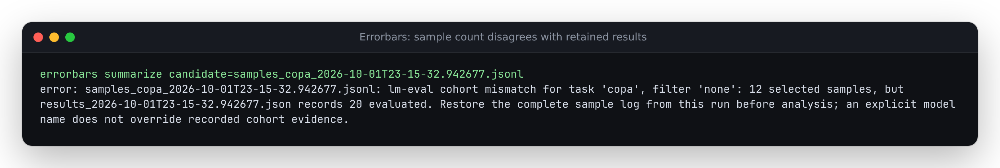

# A valid sample file can still be a damaged cohort

At baseline `1c1600b`, deleting records from an lm-eval sample file did not
invalidate its analysis, even when the matching results file recorded a
larger evaluated count. This changes the population being analyzed. A native
COPA capture from `sshleifer/tiny-gpt2` has 20 samples and mean accuracy 0.6.
Keeping only its 12 correct samples produced a successful 1.0 estimate beside
the unchanged sidecar declaring 20 evaluated samples.

The corrected source checks `n-samples[task].effective` against the selected
filter's records. An explicit model name changes attribution, not the
recorded cohort. Malformed matching results or declared counts also stop
the import. CLI rejection occurs before reports or exports are written.
Results sidecars now remain protected output inputs even when the model is
explicitly named; previously an import could replace that sidecar with CSV.

| Actual CLI workflow | Baseline | Corrected source |
| --- | --- | --- |
| Complete native COPA, automatic or explicit model | 20 questions, 0.6 | Unchanged |
| First five complete JSONL records with unchanged sidecar | Successful five-question estimate | Count mismatch; exit 1 |
| Only the 12 correct native records, explicit model | 1.0 accuracy; exit 0 | 12 versus 20; exit 1 |
| One record removed, compare / leaderboard / import | Analysis or export succeeds | Exit 1; previous export preserved |
| One unique record added | Successful 21-question estimate | 21 versus 20; exit 1 |
| Complete three-filter file, select `maj@8` | Four questions | Unchanged; count is per filter |
| One `maj@8` record removed | Successful three-question estimate | Three versus four; exit 1 |
| Same damaged file, select complete `score-first` | Four questions | Unchanged |
| Explicit-name import to results sidecar or its hard link | Replaces count evidence with CSV | Exit 1; all input bytes preserved |

## Reproduce

From a source checkout with the locked development environment:

```bash
uv sync --locked --group dev --extra all
uv run python studies/lm-eval-cohorts/replay.py --src src --out /tmp/cohort-after.json
```

To inspect the old behavior without altering the checkout:

```bash
mkdir -p /tmp/claude-1000/errorbars-cohort-before
git archive 1c1600b src | tar -x -C /tmp/claude-1000/errorbars-cohort-before
uv run python studies/lm-eval-cohorts/replay.py \
  --src /tmp/claude-1000/errorbars-cohort-before/src \
  --out /tmp/cohort-before.json --observe-only
```

The replay runs 20 actual CLI workflows, not direct calls to a helper that
duplicates the implementation. [Before](results/before.json) shows 12
disagreements with the corrected contract; [after](results/after.json)
shows zero. Each record contains stdout, stderr, exit status and file hashes
before and after. Only the disposable directory prefix is normalized.

The native input files remain unedited under `tests/fixtures/`. Their hashes
are recorded in each result. Removed/added records, damaged metadata and
foreign metadata are labelled derived controls. The three-filter GSM8K
sample file is native lm-eval 0.4.13 output; its four-sample count sidecar is
a constructed control. These are importer checks, not model-quality evidence.

## What the count establishes

lm-eval [records effective evaluated counts](https://github.com/EleutherAI/lm-evaluation-harness/blob/v0.4.13/lm_eval/evaluator_utils.py)
separately from original dataset sizes. Its
[tracker](https://github.com/EleutherAI/lm-evaluation-harness/blob/v0.4.13/lm_eval/loggers/evaluation_tracker.py)
uses the same timestamp in matching results and samples filenames and writes
them separately. A syntactically complete but shortened sample file can
therefore disagree with its retained results file. The native COPA sidecar
records `original=100, effective=20`; the fix accepts all 20 samples rather
than demanding the whole 100-question dataset.

Only the selected filter is checked. The tool does not treat all filter
records as additional independent questions, and an unselected filter's
missing records do not invalidate a complete selected filter. A task-level
effective count cannot explain legitimate unequal counts among metrics;
such mismatches are conservatively rejected rather than assigned an invented
metric-specific cohort.

Missing sidecars, missing task/count declarations and renamed samples remain
usable with an explicit model identity, with no completeness guarantee.
Unrelated timestamps never provide count evidence. Equal counts cannot detect
replacements, simultaneous edits to counts and samples, or discarded entire
tasks. This is a consistency check on recorded evidence, not authentication
or proof that every originally intended question was evaluated. Canonical
CSV files and direct score arrays do not carry native sidecar counts.

The change is local and unreleased. No PyPI package or hosted calculator
deployment is claimed. The existing web build is `cd web && npm run build`,
with output in `web/dist/`.

## Artifact verification

A clean archive of code commit `3305216` passed a fresh locked install,
Ruff, strict mypy, all 710 Python tests, and wheel/source-distribution
builds. All 20 CLI workflows also passed using only the built wheel on
[Python 3.14.7 / NumPy 2.5.3](results/installed-current.json) and the
declared floor [Python 3.10.21 / NumPy 1.24.0](results/installed-floor.json).
The replays cleared `PYTHONPATH`; no source override was used for those runs.

The clean web install passed lint, typecheck, 691 unit checks and its
production build. The existing browser suite passed 52 checks in Chromium
and Firefox; 30 standalone comparison-report checks also passed using the
installed wheel, including offline viewing, downloads and mobile layouts.
The [verification receipt](results/verification.json) records the exact
commands and the built artifact sizes and SHA-256 hashes. Browser and
installation logs are retained alongside it. These verify compatibility
with the local build, not a hosted deployment.



The terminal image was rendered from [unedited installed stderr](../../docs/assets/lm-eval-cohorts.ansi)
and visually inspected. It is the 12-versus-20 rejection above.
