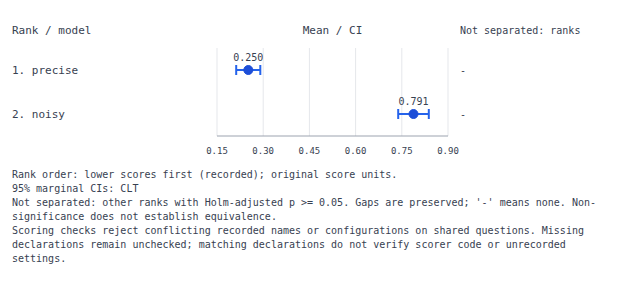

# Metric declarations can change the meaning of a leaderboard

This study uses **constructed log likelihoods**, passed through the real
lm-eval **0.4.13** evaluator and its native result writers. It does not measure
a trained model or a public benchmark. Both runs use the same 32 local
documents, targets and scoring function; no external dataset, model weights,
API calls or paid service are involved.

At baseline `d76cadd`, errorbars accepted the selected scalar fields as mean
scores and always ranked the largest mean first. The matching native results
files already recorded each metric's direction and aggregation.

| Selected metric | Native harness result: precise / noisy | Previous result | Corrected behavior |
| --- | --- | --- | --- |
| `mean_nll`, mean, lower is better | 0.25 / 0.790625 | Noisy ranked first | Precise ranked first; original loss values retained |
| `likelihood`, mean, higher is better | 0.7836766094578247 / 0.4581389677929259 | Precise ranked first | Same ordering and estimates |
| `perplexity`, exponential aggregation, lower is better | 1.2840254166877414 / 2.204773979462882 | Displayed means -0.25 / -0.790625 | Refused before inference or export: raw scalar inputs are not perplexity scores |



The [before](results/before.json) and [after](results/after.json) receipts
contain library results, actual CLI exit/output checks, and SHA-256/size
receipts for all four unedited [native capture files](captures/).
`capture.py` is the exact generator used. Its scripted model returns gold
log likelihoods with a small or larger negative magnitude; one stable scorer
returns negative log likelihood, likelihood and the native perplexity inputs.

The harness's own [aggregation implementation](https://github.com/EleutherAI/lm-evaluation-harness/blob/v0.4.13/lm_eval/api/metrics.py)
defines perplexity as `exp(-mean(items))`. Its
[task guide](https://github.com/EleutherAI/lm-evaluation-harness/blob/v0.4.13/docs/task_guide.md)
separates per-item results, aggregation and `higher_is_better` declarations.
Errorbars estimates question means and their uncertainty. Replacing those
formulas with a generic nonlinear aggregation would require a separate
estimand and uncertainty method; changing the label or sign would not fix it.

## Use the corrected source

Install this checkout. These additions are unreleased; the registry package
and hosted site were not updated by this work.

```bash
uv sync --group dev --extra all
uv run errorbars leaderboard studies/metric-contract/captures --metric mean_nll
uv run errorbars import lm-eval studies/metric-contract/captures --metric mean_nll -o /tmp/loss-scores.csv
uv run errorbars leaderboard /tmp/loss-scores.csv --json --plot /tmp/loss-board.svg
```

For your own normalized CSV/JSONL, the optional `higher_is_better` column
contains `true`, `false` or an empty/null unknown value. It does not require
a scorer name. `ColumnMap(higher_is_better="direction")` or
`--higher-is-better-col direction` selects a differently named column.
An empty declaration is retained as unknown when other rows have one.

For scores without direction metadata:

```bash
uv run errorbars leaderboard your-losses.csv --score-direction lower
```

Python callers can use `build_leaderboard(data, higher_is_better=False)`.
The flag/argument supplies missing direction; it cannot contradict a known
declaration. A board with both known higher-first and lower-first observations
is refused. Repeated samples for one model/question cannot disagree either.
Absent direction uses the historical higher-first ordering, labelled `default`.
With some known and some unknown directions, automatic ranking labels its
assumption in a warning; it does not fill in the missing row metadata.

Direction survives filtering, concatenation, canonical CSV and question-level
comparison JSON. The standalone report's complete JSON download retains each
observation's boolean or null. Its filtered question CSV adds
`higher_is_better_a` and `higher_is_better_b`, each a JSON array of distinct
observed declarations, including null when present. This CSV remains an
aggregated question ledger, rather than the canonical observation import.

## Interpretation and limits

- Scores, means and A - B differences retain original units. Lower-first rank
  order does not negate scores, reverse confidence interval endpoints or
  change two-sided significance decisions. Tests check those decisions against
  SciPy's independent paired t implementation on the retained native samples.
- Only available declarations are checked. Metric names, signs and filenames
  do not establish direction or aggregation. Missing sidecars and absent
  declarations stay unchecked; matching declarations do not authenticate the
  data or verify custom scorer/aggregator code.
- Recorded aggregations other than `mean` or `nanmean` are refused, including
  custom function source. Such functions are never imported or executed.
  Since accepted scores are finite, the harness's `nanmean` is an ordinary
  arithmetic mean on these inputs. Missing or non-finite scores are still refused.
- A native lower-first declaration also requires a recorded mean aggregation.
  For example, perplexity's lower-first direction cannot be applied to its
  raw log likelihoods. Restore the matching result configuration or supply
  separately reviewed per-question scores with documented units.
- Mean-based analysis remains equally weighted by question. A task's mean
  aggregation declaration alone does not establish equal sampling weights,
  comparable cohorts, appropriate grouping or equivalent graders.

## Reproduce

The retained capture needs only errorbars, with no lm-eval dependency:

```bash
uv run python studies/metric-contract/replay.py --out /tmp/metric-replay.json
uv run python studies/metric-contract/verify.py --out /tmp/metric-workflows.json --artifacts /tmp/metric-artifacts
```

`verify.py` runs actual CLI commands for native and normalized imports,
original-unit comparison HTML, SVG/JSON/terminal output, explicit directions,
renamed models, rejected overrides and refused nonlinear imports. It checks
that rejected operations preserve existing output artifacts.

To generate new native captures, install `lm-eval==0.4.13` in a separate
environment and run `python capture.py --out /path/to/new-captures`.
The capture uses a scripted `DummyLM` subclass, not an external model backend.

[Clean-source, installed-wheel and offline-browser verification](../../docs/verification-metric-contract-2026-10-15.md)
includes the retained receipts, screenshot inspection and publication boundary.
