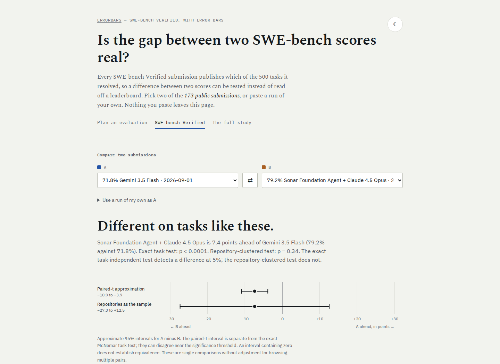
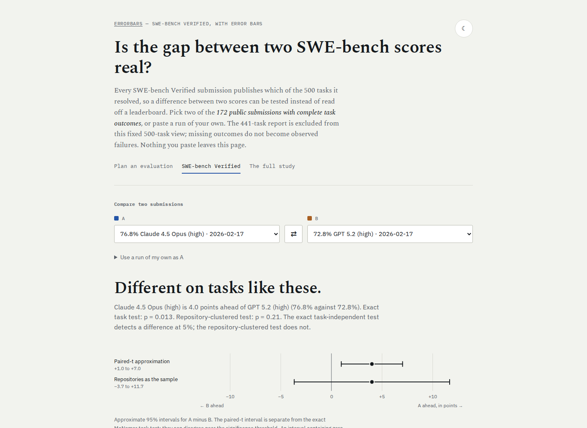
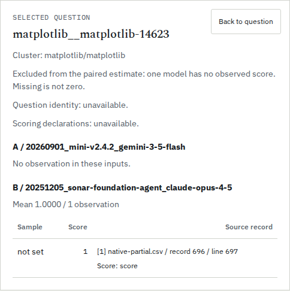

# Missing task records are not observed failures

One retained SWE-bench Verified submission has 441 per-task records and an
explicit evaluated-task mask. The source CSV converter, historical study and
browser view nevertheless treated all 500 tasks as observed. The other 59
became zeroes. This manufactured 41 peer-only successes in one paired comparison
and changed the browser's conclusion.

This correction keeps two denominators distinct: the official benchmark score
and the outcomes supported by the per-task file. It does not claim that an
observed subset estimates full-benchmark performance or establish why records
are absent.

## Native evidence

The input is the public submission
`20260901_mini-v2.4.2_gemini-3-5-flash` at experiments commit
`40f164d5b8f1d249bf95a6df8b74b577fd8e519d`:

- [Pinned native per-instance file](https://raw.githubusercontent.com/SWE-bench/experiments/40f164d5b8f1d249bf95a6df8b74b577fd8e519d/evaluation/verified/20260901_mini-v2.4.2_gemini-3-5-flash/per_instance_details.json),
  retained byte-for-byte as [partial-details.json](native/partial-details.json).
  It contains 441 task records and 359 resolutions: 33,544 bytes, SHA-256
  `2217bde53ceffe19cfdb937fabe9c30018b631c973d6af42bcc77049d4ef12ed`.
- [Pinned submission metadata](https://raw.githubusercontent.com/SWE-bench/experiments/40f164d5b8f1d249bf95a6df8b74b577fd8e519d/evaluation/verified/20260901_mini-v2.4.2_gemini-3-5-flash/metadata.yaml)
  records the official 71.8% score. That is 359/500; it remains unchanged.
- The existing [packed outcomes](../swe-bench-verified/data/outcomes.json)
  already retained both an `evaluated` mask and `n_evaluated: 441`. The repair
  honors that evidence instead of inferring zeroes outside the mask.

The [official harness guide](https://www.swebench.com/SWE-bench/guides/evaluation/#what-the-counts-mean)
also distinguishes submitted, completed, unresolved and error counts. This
repair does not reinterpret those states or infer a stopping cause from a
missing record. A resolved-only input retains its explicitly documented
full-benchmark convention; an explicit evaluated mask supplies different evidence.

## Before and after on an actual peer

The peer is the retained Sonar Foundation Agent / Claude Opus 4.5 submission
`20251205_sonar-foundation-agent_claude-opus-4-5`. It has all 500 outcomes and
396 successes. Of those successes, 355 are on the 441 tasks recorded for the
partial submission.

| Comparison input | Shared tasks | Partial run | Peer | A minus B | Exact McNemar p | Repository CR2 p |
|---|---:|---|---|---:|---:|---:|
| Previous converter: add 59 unobserved zeroes | 500 | 359/500 | 396/500 | -7.40 points | 0.000059736 | 0.337919 |
| Corrected converter: recorded intersection | 441 | 359/441 | 355/441 | +0.907 points | 0.643969 | 0.760177 |

The exact task test's discordant counts change from 60 peer-only / 23
partial-only successes to 19 / 23. The 41 invented peer-only successes were
tasks absent from the partial file. The other 18 absent records were shown as
failures by both systems. No new model evaluation was run.

The [captured actual baseline](results/before.json) includes converter/CSV
hashes and the CLI result. The [corrected CLI replay](results/source-replay.json)
contains all 941 observed input rows' counts, summary and comparison. An
[independent oracle](results/oracle.json) uses the native records, general
dense OLS CR2 projections, SciPy Student-t tails and SciPy's exact binomial test.
It does not reuse Errorbars' covariance or distribution implementation.

The 441-task subset is not known to be a random sample. Its mean and paired
comparison describe that observed cohort under the stated statistical model;
they do not replace the official 71.8% full-benchmark score or establish a new
ranking against complete runs.

## Export and review the actual cohort

From this source checkout, with Errorbars installed:

```bash
python studies/swe-bench-verified/to_csv.py \
  20260901_mini-v2.4.2_gemini-3-5-flash \
  20251205_sonar-foundation-agent_claude-opus-4-5 > pair.csv
errorbars compare pair.csv --html cohort.html
```

The converter prints a notice on stderr and exports 441 rows for the partial
run and 500 for the peer. The CLI uses their 441-task intersection and retains
the 59 excluded questions. In the self-contained HTML report, inspection and
CSV/JSON downloads preserve absent observations; a missing grade does not
become zero. The converter itself is a study script in the checkout, not a file
shipped in the Python wheel.

| Input evidence | Export policy |
|---|---|
| Public packet with an evaluated mask | Export only task IDs in the validated mask |
| Public resolved-only packet | Retain the documented full-benchmark convention |
| `--mine` resolved-ID JSON or text list | Retain the documented full-benchmark convention |
| Invalid hex, out-of-range bits, inconsistent declared counts or resolved IDs outside the evaluated set | Refuse before writing any CSV |
| Partial evaluated count without a mask identifying the tasks | Refuse; do not guess the cohort |

`--list` retains the official resolved/500 score and labels incomplete coverage.
An explicit mask determines its cohort even when a redundant evaluated count
is absent; any declared count must agree. The
[complete-export receipt](results/complete-exports.json) checks all 174 complete
packets byte-for-byte against the original converter: 87,000 rows and 6,332,563
CSV bytes unchanged. That exporter check includes two packets whose score
metadata conflicts with their task file; the statistical study continues to
exclude those two identities.

## Fixed-cohort study and browser

The original study assumes the same 500-task matrix for every run. It now
excludes the incomplete packet explicitly, leaving 172 complete,
score-consistent submissions. Partial data stay in the source corpus and remain
usable through the CSV workflow above. The fixed browser view applies the same
eligibility policy and states why the 441-task report is excluded.

| Study quantity | Previous | Corrected |
|---|---:|---:|
| Submissions admitted to fixed-cohort inference | 173 including one incomplete run | 172 complete runs |
| Submissions scoring at least 60% | 78 | 77 |
| Pairs among those submissions | 3,003 | 2,926 |
| Pairs less than three points apart | 874 | 842 |
| Such pairs significant under the study's paired-t test | 1 | 1 |
| Largest nonsignificant paired-t gap | 4.2 points | 4.0 points |

The gap figures, prose and browser caption were regenerated. The leading
pair comparisons, top-20 corrected conclusions and record-progression
conclusions remain unchanged. The original published study receipt and an
actual baseline recomputation are both retained in `before.json`; old captured
numbers are not overwritten to resemble corrected evidence.





[`browser.mjs`](browser.mjs) exercised production builds in Chromium and Firefox
at 375 and 1440 pixels, including offline swapping and resolved-only own-run
inputs. The [baseline](results/before-browser.json) and
[corrected](results/after-browser.json) receipts include actual displayed text,
the 59 falsely observed failures, served-byte hashes, overflow and request/error
checks. Six page screenshots were captured and inspected. An old link to an
excluded submission follows the page's existing unavailable-ID fallback; the
selected complete submissions remain explicit in the controls and URL.

The installed wheel's offline comparison report was also exercised in both
engines at both widths. It retains 441 shared and 59 peer-only questions in the
complete JSON download and all 59 absent grades in filtered CSV. Inspecting
an excluded question explicitly says "Missing is not zero"; filtering does not
recompute inference. The two report inspector screenshots were inspected too.



## Reproduce the checks

```bash
python studies/observed-cohorts/oracle.py
python studies/observed-cohorts/replay.py --out replay.json
node studies/observed-cohorts/browser.mjs web/dist after browser-output
```

The oracle requires development NumPy/SciPy. The actual CLI replay needs only
the installed package's required NumPy dependency and this source checkout.
Bare [Python 3.10 / NumPy 1.24 wheel](results/wheel310-replay.json),
[Python 3.14 wheel](results/wheel314-replay.json), and
[Python 3.12 source-distribution](results/sdist312-replay.json) replays agree.
Those artifacts were built at `80f51ec`, after the primary-summary repair;
the cohort converter is the separately identified checkout script.

This is source and local production-build verification. Registry release and
hosted deployment are separate publication stages.

## Clean artifact verification

The clean archive of `45cc476` passed Ruff, strict mypy (21 source files), all
840 Python tests on Python 3.14.7, and all 43 converter checks on Python 3.10.21
with the minimum dependency environment. Node 24.22.0 installed the locked web
dependencies, passed lint/types and 693 unit checks, built the static site, and
passed 52 production-browser plus 42 installed offline-report workflows in
Chromium/Firefox. Browser suites used separate artifact directories and fixed
source files; overlapping exploratory runs are not counted as verification.

Both wheel and source distribution were built from that archive. A fresh bare
wheel installation replayed the native comparison and all nine summary cases.
All 29 package files match the archive and the previously tested minimum-NumPy
wheel byte-for-byte. The [verification receipt](results/verification.json)
retains artifact hashes, package-file hashes and all 65 static build files;
the [final wheel replay](results/wheel-final-replay.json) retains the actual
installed CLI outputs. Source, registry and hosted publication states in this
receipt describe this local verification stage.

## Public source and live build

The [public-source receipt](results/public-source.json) verifies 137 pinned raw
files at `45cc476`, including the native file, converter, case study, runtime
and browser source. A fresh **pip** installation of PyPI 0.2.4 reproduced the
old primary summary. The documented `--force-reinstall` Git command upgraded
that same environment; all 29 package files matched the clean archive, all nine
summary cases passed, and the downloaded public converter/native files replayed
the 441-task comparison. This keeps checkout tooling distinct from installed
wheel contents.

The tested Node 24 static build was pushed to `gh-pages` as `c411e97`. The
[canonical HTTP receipt](results/hosted.json) verified the root entry before
and after every one of the 65 build files, including explicit `index.html` and
`swe-bench.html`. Two polling passes were needed; an initial stale response
was not treated as publication success. The
[hosted browser receipt](results/hosted-browser.json) then checked both engines
at 375 and 1440 pixels: 172 complete submissions, the partial run excluded,
the ordinary complete comparison unchanged, and offline swapping with no
external requests, script errors or CSP violations. No registry release or tag
was created.
