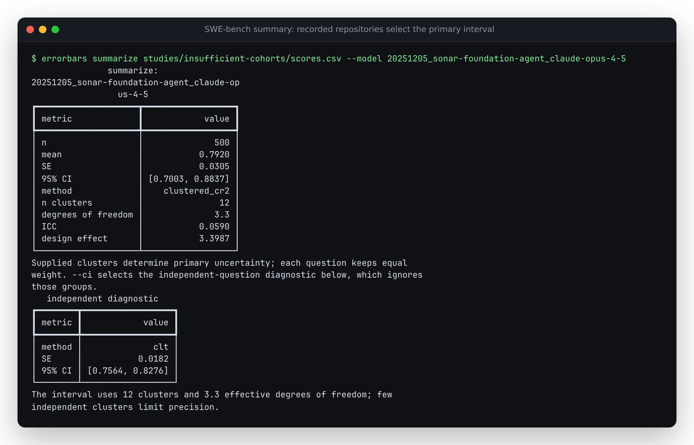
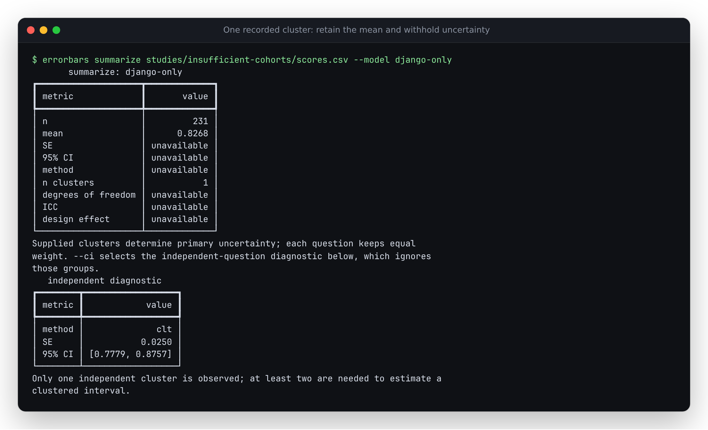

# A summary's primary interval must respect the recorded groups

On the same 500 SWE-bench task outcomes, `summarize` previously presented an
independent-question interval first, while `leaderboard` selected repository
clusters. The summary's separate clustering table held the correct grouped
estimate, but its top-level JSON fields and first terminal table ignored those
groups. Consumers selecting `ci_low` and `ci_high` got a different answer from
the board without choosing a different statistical target.

This unreleased source correction shares one selection policy between both
commands. It changes the primary summary fields for grouped data; it does not
change the CR2 covariance formula, rerun an evaluation, or establish population
coverage for these observed scores.

## Reproduce on retained outcomes

```bash
errorbars summarize studies/insufficient-cohorts/scores.csv \
  --model 20251205_sonar-foundation-agent_claude-opus-4-5 --json
```

The source is the same retained public submission used in the
[insufficient-cohorts reproduction](../insufficient-cohorts/README.md): 500
tasks, 12 repositories, mean 0.792. No upstream outcomes were fetched again.
The [captured baseline](results/before.json) identifies the pre-change revision.

| Estimate | SE | 95% interval | Effective degrees of freedom |
|---|---:|---|---:|
| Previous primary summary, independent questions | 0.018170 | [0.756388, 0.827612] | normal approximation |
| Existing leaderboard and corrected primary summary, recorded repositories | 0.030459 | [0.700290, 0.883710] | 3.331 |



These are marginal intervals for different extrapolations: more questions like
the observed ones under independent sampling, versus new independent groups
under the clustered working model. Supplied group assignments determine the
primary estimate. Repository membership does not itself prove that repositories
are independent or representative of future codebases.

## Preserve the observation when uncertainty is unavailable

```bash
errorbars summarize studies/insufficient-cohorts/scores.csv --model django-only --json
```

This deliberately constructed subset covers 231 Django questions from that
submission, with 191 observed successes. Previously the summary exited 1 and
returned no mean. It now retains `mean: 0.8268398268398268`, counts, a warning,
`method: "unavailable"`, and `interval_status: "fewer_than_two_clusters"`.
Primary SE and interval endpoints are `null`. The independent-question estimate
is retained under `unclustered`, not substituted for the missing grouped one.
ICC and design effect are also unavailable with one group.



| Observed independent units | Primary result |
|---|---|
| Multiple questions in at least two recorded groups | CR2 SE, effective-df Student-t interval |
| Multiple questions in only one recorded group | Descriptive mean; `fewer_than_two_clusters` |
| One continuous or repeated-generation question | Descriptive mean; `fewer_than_two_questions` |
| One independent binary answer with automatic/Wilson selection | Existing Wilson interval |
| Independent questions, or one unique cluster label per question | Existing requested/automatic independent-question method |

Repeated generations are averaged within each question before this selection.
A question with twelve generations does not get twelve times another question's
weight. With one question, a within/between-question decomposition is not emitted:
there is no observed between-question variation to estimate. Explicit Wilson
requests still reject continuous scores and repeated-generation means.

## CLI and JSON compatibility

With supplied multi-question groups, `--ci auto|clt|wilson|bootstrap` selects the
**independent diagnostic**. It cannot override the primary grouped estimate.
`--cluster-col none` explicitly chooses independent-question analysis when that
is the intended target. No group is silently discarded.

Primary `method`, `se`, `ci_low`, and `ci_high` now describe the selected grouped
estimate. `interval_status`, `n_clusters`, `dof_clustered`, `warnings`, and
`unclustered` expose its basis. The old nested `clustered.clustered_se`,
`clustered_ci_low`, `clustered_ci_high`, and `clustered_dof` remain numeric
aliases for available grouped estimates and become null when unavailable.
Ungrouped numeric results and ordinary leaderboard entries retain their methods.

## Independent audit and installed replay

[`audit.py`](audit.py) reconstructs the general intercept-only OLS residual-maker
matrix, each cluster's inverse-square-root leverage adjustment, CR2 score
projections, and the Satterthwaite degrees of freedom. It compares the **actual
summary CLI** with those covariance calculations and SciPy Student-t quantiles.
It shares no Errorbars covariance or t-distribution implementation. The
[clubSandwich confidence-interval documentation](https://jepusto.github.io/clubSandwich/reference/conf_int.html)
describes this CR2/Satterthwaite small-sample approach; the
[Pustejovsky and Tipton paper](https://arxiv.org/abs/1601.01981) explains its
working-model assumptions and limits.

The [retained census](results/census.json) covers all 173 submissions accepted
by the parent study's reported-score consistency policy. Every primary estimate
matches the independent oracle; maximum absolute error across means, SEs,
endpoints and degrees of freedom was 1.55e-14. Clustered intervals are wider in
170 cases and narrower in three; clustering does not invariably widen an
interval. The census is a numerical audit, not an empirical coverage study.

The census honors the explicit evaluated mask of the one partial public run:
172 cohorts have 500 observations and one has 441. Unevaluated tasks are not
failures. Its observed-subset mean is not a replacement for the official
500-task benchmark score, and means from different cohorts do not establish
a model ranking. Two submissions remain excluded under the parent study's
existing reported-score discrepancy rule.

```bash
python studies/summary-inference/audit.py --out census.json
python studies/summary-inference/replay.py --out replay.json
```

The audit needs development NumPy/SciPy. [`replay.py`](replay.py) needs only an
installed Errorbars artifact and its required NumPy dependency. It exercises
all four CI choices, explicit independent analysis, one-cluster and one-question
states, and unequal repetitions against the retained oracle values. The
[source replay](results/source-replay.json) retains complete outputs. Terminal
images are renders of the [unedited full-run output](results/terminal.ansi) and
[unedited one-cluster output](results/one-cluster-terminal.ansi).

[`compatibility.py`](compatibility.py) also compares the complete actual
leaderboard JSON before and after this change: 173 models, 86,441 observed
scores, 14,878 paired comparisons and two groups are identical, including
intervals, warnings and rank comparisons. The
[receipt](results/leaderboard-compatibility.json) retains the baseline revision
and canonical JSON hash. This audit honors the partial run's mask and does not
reproduce the historical study's assumption of 500 observations for every run.
